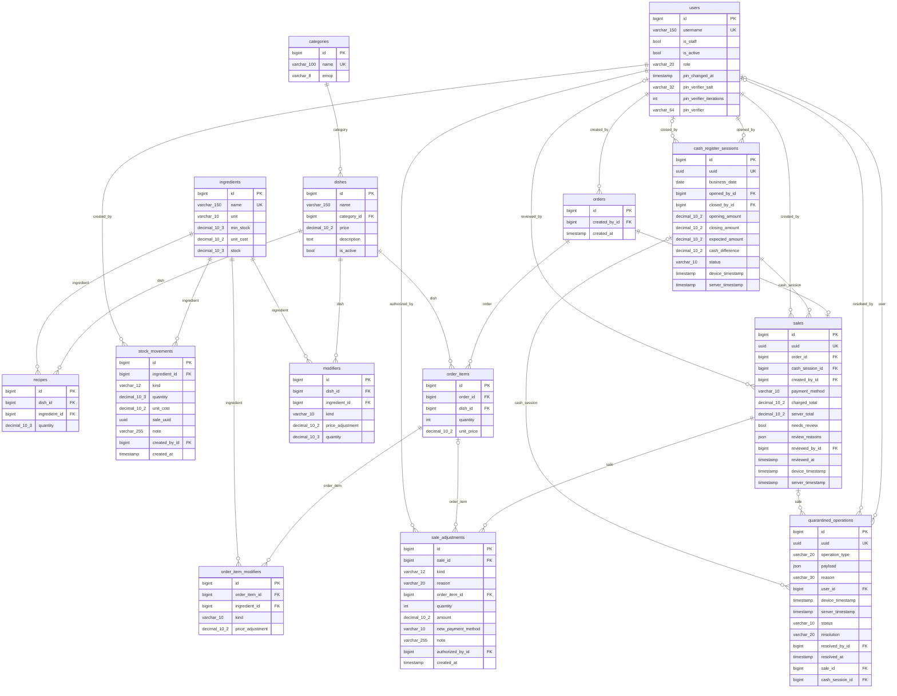

# Diagrama entidad-relación y diccionario de datos

WBS 1.6.1. Generado de los modelos de Django (`apps/*/models.py`) sobre `main` después de los modelos de movimientos de inventario y ajustes de venta. Si cambia un modelo, se actualiza este documento en el mismo PR.

De la tabla `users` solo se muestran los campos propios del SGFT y los de Django que usa la aplicación (`id`, `username`, `is_active`, `is_staff`); los demás vienen de `AbstractUser`. Las tablas internas de Django (sesiones, permisos, caché) no aparecen.

## Diagrama

## Diccionario de datos

Dinero en `decimal(10,2)`; cantidades de insumo en `decimal(10,3)`, siempre en la unidad del insumo. Las fechas y horas se guardan en UTC (`USE_TZ = True`).

### `users` — usuario (`accounts.User`)

Cuenta del personal. El rol decide qué puede hacer; las cuentas se desactivan, nunca se borran. El PIN de Administrador es la contraseña (6 dígitos, con hash de Django, en `password`, que no se muestra); los campos `pin_verifier*` son el verificador PBKDF2 para abrir la caja sin red.

| Campo | Tipo | Nulo | Descripción | Notas |
|---|---|---|---|---|
| `id` | bigint | no | ID | PK |
| `username` | varchar(150) | no | nombre de usuario | único; Obligatorio. Longitud máxima 150 caracteres alfanuméricos. Letras, dígitos y @/./+/-/_ únicamente. |
| `is_staff` | bool | no | es staff | por omisión `False`; Indica si el usuario puede ingresar a este sitio de administración. |
| `is_active` | bool | no | activo | por omisión `True`; Indica si el usuario debe ser tratado como un usuario activo. Desactive este campo en lugar de eliminar usuarios. |
| `role` | varchar(20) | no | rol | valores: `admin`, `cashier`; por omisión `cashier` |
| `pin_changed_at` | timestamp | sí | cambio del PIN |  |
| `pin_verifier_salt` | varchar(32) | no | sal del verificador sin red |  |
| `pin_verifier_iterations` | int | no | iteraciones del verificador sin red | por omisión `0` |
| `pin_verifier` | varchar(64) | no | verificador sin red |  |

### `categories` — categoría (`catalog.Category`)

Agrupa los platillos en Nueva venta y Productos.

| Campo | Tipo | Nulo | Descripción | Notas |
|---|---|---|---|---|
| `id` | bigint | no | ID | PK |
| `name` | varchar(100) | no | nombre | único |
| `emoji` | varchar(8) | no | emoji |  |

### `dishes` — platillo (`catalog.Dish`)

Platillo del menú con su precio vigente. Se oculta con `is_active`; nunca se borra.

| Campo | Tipo | Nulo | Descripción | Notas |
|---|---|---|---|---|
| `id` | bigint | no | ID | PK |
| `name` | varchar(150) | no | nombre |  |
| `category_id` | bigint | no | categoría | FK → `categories` (PROTECT) |
| `price` | decimal(10,2) | no | precio |  |
| `description` | text | no | descripción |  |
| `is_active` | bool | no | activo | por omisión `True` |

Restricciones en la base de datos:

- `dish_price_gte_0`: `price >= 0`.

### `ingredients` — insumo (`catalog.Ingredient`)

Insumo con su unidad de medida, mínimo, costo y existencia actual. La existencia puede ser negativa (regla 10) y solo cambia por un movimiento de inventario.

| Campo | Tipo | Nulo | Descripción | Notas |
|---|---|---|---|---|
| `id` | bigint | no | ID | PK |
| `name` | varchar(150) | no | nombre | único |
| `unit` | varchar(10) | no | unidad de medida | valores: `kg`, `g`, `L`, `ml`, `pzas` |
| `min_stock` | decimal(10,3) | no | stock mínimo | por omisión `0` |
| `unit_cost` | decimal(10,2) | no | costo unitario | por omisión `0` |
| `stock` | decimal(10,3) | no | existencia | por omisión `0`; Cantidad actual en inventario (puede ser negativa). |

Restricciones en la base de datos:

- `ingredient_unit_cost_gte_0`: `unit_cost >= 0`.
- `ingredient_min_stock_gte_0`: `min_stock >= 0`.

### `recipes` — receta (`catalog.Recipe`)

Cuánto de cada insumo lleva una unidad del platillo; de aquí sale el descuento al vender.

| Campo | Tipo | Nulo | Descripción | Notas |
|---|---|---|---|---|
| `id` | bigint | no | ID | PK |
| `dish_id` | bigint | no | platillo | FK → `dishes` (PROTECT) |
| `ingredient_id` | bigint | no | insumo | FK → `ingredients` (PROTECT) |
| `quantity` | decimal(10,3) | no | cantidad requerida |  |

Restricciones en la base de datos:

- `unique_dish_ingredient`: única por `dish, ingredient`.
- `recipe_quantity_gt_0`: `quantity > 0`.

### `stock_movements` — movimiento de inventario (`inventory.StockMovement`)

Historial de cada cambio de existencia: compra, venta, merma o ajuste, con la cantidad con signo. La venta se referencia por su UUID, sin llave foránea, porque `inventory` no depende de `pos`.

| Campo | Tipo | Nulo | Descripción | Notas |
|---|---|---|---|---|
| `id` | bigint | no | ID | PK |
| `ingredient_id` | bigint | no | insumo | FK → `ingredients` (PROTECT) |
| `kind` | varchar(12) | no | tipo | valores: `purchase`, `sale`, `waste`, `adjustment` |
| `quantity` | decimal(10,3) | no | cantidad | Positiva entra, negativa sale. |
| `unit_cost` | decimal(10,2) | sí | costo unitario | Solo en compras. |
| `sale_uuid` | uuid | sí | UUID de la venta |  |
| `note` | varchar(255) | no | motivo o nota |  |
| `created_by_id` | bigint | no | registrado por | FK → `users` (PROTECT) |
| `created_at` | timestamp | no | fecha | se fija al crear |

Restricciones en la base de datos:

- `inventory_movement_quantity_not_0`: `quantity != 0`.
- `inventory_purchase_adds_stock`: `kind != 'purchase' o quantity > 0`.
- `inventory_sale_and_waste_subtract_stock`: `kind no en ('sale', 'waste') o quantity < 0`.
- `inventory_unit_cost_gte_0`: `unit_cost es nulo o unit_cost >= 0`.
- `inventory_sale_has_uuid`: `kind != 'sale' o sale_uuid no es nulo`.

### `cash_register_sessions` — turno de caja (`pos.CashRegisterSession`)

Turno de caja: uno por jornada y uno abierto a la vez; lo abre y lo cierra un Administrador. Guarda el efectivo inicial, el contado, el esperado y la diferencia.

| Campo | Tipo | Nulo | Descripción | Notas |
|---|---|---|---|---|
| `id` | bigint | no | ID | PK |
| `uuid` | uuid | no | UUID | único; por omisión `uuid4()` |
| `business_date` | date | no | fecha de negocio |  |
| `opened_by_id` | bigint | no | abierto por | FK → `users` (PROTECT) |
| `closed_by_id` | bigint | sí | cerrado por | FK → `users` (PROTECT) |
| `opening_amount` | decimal(10,2) | no | efectivo inicial |  |
| `closing_amount` | decimal(10,2) | sí | efectivo al cierre |  |
| `expected_amount` | decimal(10,2) | sí | efectivo esperado |  |
| `cash_difference` | decimal(10,2) | sí | diferencia de caja |  |
| `status` | varchar(10) | no | estado | valores: `open`, `closed`; por omisión `open` |
| `device_timestamp` | timestamp | no | hora del dispositivo |  |
| `server_timestamp` | timestamp | no | hora del servidor | se fija al crear |

Restricciones en la base de datos:

- `pos_session_one_per_day`: única por `business_date`.
- `pos_session_single_open`: única por `status` cuando `status = 'open'`.
- `pos_session_opening_amount_gte_0`: `opening_amount >= 0`.
- `pos_session_closing_amount_gte_0`: `closing_amount es nulo o closing_amount >= 0`.

### `orders` — pedido (`pos.Order`)

Pedido que se cobra en una venta.

| Campo | Tipo | Nulo | Descripción | Notas |
|---|---|---|---|---|
| `id` | bigint | no | ID | PK |
| `created_by_id` | bigint | no | creado por | FK → `users` (PROTECT) |
| `created_at` | timestamp | no | fecha | se fija al crear |

### `order_items` — línea de pedido (`pos.OrderItem`)

Línea del pedido con el precio cobrado por unidad, que no cambia si después cambia el catálogo.

| Campo | Tipo | Nulo | Descripción | Notas |
|---|---|---|---|---|
| `id` | bigint | no | ID | PK |
| `order_id` | bigint | no | pedido | FK → `orders` (PROTECT) |
| `dish_id` | bigint | no | platillo | FK → `dishes` (PROTECT) |
| `quantity` | int | no | cantidad |  |
| `unit_price` | decimal(10,2) | no | precio unitario |  |

Restricciones en la base de datos:

- `pos_orderitem_quantity_gt_0`: `quantity > 0`.
- `pos_orderitem_unit_price_gte_0`: `unit_price >= 0`.

### `modifiers` — modificador (`pos.Modifier`)

Extras y «quitar ingrediente» que ofrece cada platillo, con su ajuste de precio y la cantidad de insumo que descuenta un extra.

| Campo | Tipo | Nulo | Descripción | Notas |
|---|---|---|---|---|
| `id` | bigint | no | ID | PK |
| `dish_id` | bigint | no | platillo | FK → `dishes` (PROTECT) |
| `ingredient_id` | bigint | no | insumo | FK → `ingredients` (PROTECT) |
| `kind` | varchar(10) | no | tipo | valores: `add`, `remove` |
| `price_adjustment` | decimal(10,2) | no | ajuste de precio | por omisión `0` |
| `quantity` | decimal(10,3) | no | cantidad de insumo | por omisión `0`; Cuánto insumo descuenta un extra. |

Restricciones en la base de datos:

- `pos_modifier_unique_combo`: única por `dish, ingredient, kind`.
- `pos_modifier_quantity_gte_0`: `quantity >= 0`.

### `order_item_modifiers` — modificador de línea (`pos.OrderItemModifier`)

Copia de los modificadores que se cobraron en una línea.

| Campo | Tipo | Nulo | Descripción | Notas |
|---|---|---|---|---|
| `id` | bigint | no | ID | PK |
| `order_item_id` | bigint | no | línea | FK → `order_items` (PROTECT) |
| `ingredient_id` | bigint | no | insumo | FK → `ingredients` (PROTECT) |
| `kind` | varchar(10) | no | tipo | valores: `add`, `remove` |
| `price_adjustment` | decimal(10,2) | no | ajuste de precio | por omisión `0` |

### `sales` — venta (`pos.Sale`)

Venta cobrada; es inmutable (regla 7). Guarda lo cobrado y lo que calculó el servidor, las dos marcas de tiempo y si requiere revisión.

| Campo | Tipo | Nulo | Descripción | Notas |
|---|---|---|---|---|
| `id` | bigint | no | ID | PK |
| `uuid` | uuid | no | UUID | único; por omisión `uuid4()` |
| `order_id` | bigint | no | pedido | FK → `orders` (PROTECT); único |
| `cash_session_id` | bigint | no | turno | FK → `cash_register_sessions` (PROTECT) |
| `created_by_id` | bigint | no | registrada por | FK → `users` (PROTECT) |
| `payment_method` | varchar(10) | no | método de pago | valores: `cash`, `transfer` |
| `charged_total` | decimal(10,2) | no | total cobrado |  |
| `server_total` | decimal(10,2) | no | total del servidor |  |
| `needs_review` | bool | no | requiere revisión | por omisión `False` |
| `review_reasons` | json | no | motivos de revisión | por omisión `list()` |
| `reviewed_by_id` | bigint | sí | revisada por | FK → `users` (PROTECT) |
| `reviewed_at` | timestamp | sí | fecha de revisión |  |
| `device_timestamp` | timestamp | no | hora del dispositivo |  |
| `server_timestamp` | timestamp | no | hora del servidor | se fija al crear |

Restricciones en la base de datos:

- `pos_sale_charged_total_gte_0`: `charged_total >= 0`.
- `pos_sale_server_total_gte_0`: `server_total >= 0`.

### `sale_adjustments` — ajuste de venta (`pos.SaleAdjustment`)

Ajuste o cancelación de una venta, con su motivo (regla 11) y quién lo autorizó. La venta original no se modifica.

| Campo | Tipo | Nulo | Descripción | Notas |
|---|---|---|---|---|
| `id` | bigint | no | ID | PK |
| `sale_id` | bigint | no | venta | FK → `sales` (PROTECT) |
| `kind` | varchar(12) | no | tipo | valores: `cancellation`, `adjustment` |
| `reason` | varchar(20) | no | motivo | valores: `error_captura`, `devolucion`, `correccion_pago` |
| `order_item_id` | bigint | sí | línea ajustada | FK → `order_items` (PROTECT) |
| `quantity` | int | sí | unidades ajustadas |  |
| `amount` | decimal(10,2) | no | importe revertido | por omisión `0` |
| `new_payment_method` | varchar(10) | no | nuevo método de pago | valores: `cash`, `transfer` |
| `note` | varchar(255) | no | nota |  |
| `authorized_by_id` | bigint | no | autorizado por | FK → `users` (PROTECT) |
| `created_at` | timestamp | no | fecha | se fija al crear |

Restricciones en la base de datos:

- `pos_adjustment_amount_gte_0`: `amount >= 0`.
- `pos_adjustment_one_cancellation`: única por `sale` cuando `kind = 'cancellation'`.
- `pos_cancellation_covers_whole_sale`: `kind != 'cancellation' o (order_item es nulo y quantity es nulo)`.
- `pos_payment_correction_only_changes_method`: `reason != 'correccion_pago' o (amount = 0 y kind = 'adjustment' y order_item es nulo y new_payment_method != '')`.
- `pos_only_payment_correction_changes_method`: `reason = 'correccion_pago' o new_payment_method = ''`.
- `pos_adjustment_names_line_and_quantity`: `kind != 'adjustment' o reason = 'correccion_pago' o (order_item no es nulo y quantity > 0)`.

### `quarantined_operations` — operación en cuarentena (`pos.QuarantinedOperation`)

Operación sincronizada que el servidor no pudo aplicar (regla 9), con su contenido original, el motivo y cómo la resolvió el Administrador.

| Campo | Tipo | Nulo | Descripción | Notas |
|---|---|---|---|---|
| `id` | bigint | no | ID | PK |
| `uuid` | uuid | no | UUID | único |
| `operation_type` | varchar(20) | no | tipo de operación | valores: `apertura_turno`, `venta` |
| `payload` | json | no | contenido original |  |
| `reason` | varchar(30) | no | motivo | valores: `usuario_sin_permiso`, `turno_ya_abierto`, `turno_invalido`, `platillo_desconocido`, `receta_faltante`, `total_inconsistente` |
| `user_id` | bigint | sí | usuario que la registró | FK → `users` (PROTECT) |
| `device_timestamp` | timestamp | no | hora del dispositivo |  |
| `server_timestamp` | timestamp | no | hora del servidor | se fija al crear |
| `status` | varchar(10) | no | estado | valores: `pending`, `resolved`; por omisión `pending` |
| `resolution` | varchar(20) | no | resolución | valores: `apply`, `apply_no_deduction`, `discard` |
| `resolved_by_id` | bigint | sí | resuelta por | FK → `users` (PROTECT) |
| `resolved_at` | timestamp | sí | fecha de resolución |  |
| `sale_id` | bigint | sí | venta | FK → `sales` (PROTECT) |
| `cash_session_id` | bigint | sí | turno | FK → `cash_register_sessions` (PROTECT) |
